# 09 — 3D Asset Pipeline & Optimization Workflow

## Table of Contents
1. [End-to-End Asset Workflow](#1-end-to-end-asset-workflow)
2. [Blender & Mixamo Authoring Standards](#2-blender--mixamo-authoring-standards)
3. [Compression & Optimization Commands](#3-compression--optimization-commands)
4. [Asset Specifications: Desktop vs. Mobile](#4-asset-specifications-desktop-vs-mobile)
5. [Directory Structure & Naming Conventions](#5-directory-structure--naming-conventions)
6. [Licensing & Originality Rules](#6-licensing--originality-rules)

---

## 1. End-to-End Asset Workflow

```mermaid
flowchart LR
    Create["1. Model in Blender / Source Licensed Asset"] --> License["2. Log License in 3D_ASSET_LICENSE_REGISTER.md"]
    License --> Rig["3. Rig & Animate (Blender / Mixamo / Cascadeur)"]
    Rig --> Export["4. Export Binary .glb (Y-Up, Applied Transforms)"]
    Export --> Validate["5. Validate (Khronos glTF-Validator / gltf.report)"]
    Validate --> Optimize["6. Compress (gltf-transform: Draco + Meshopt + KTX2/WebP)"]
    Optimize --> Place["7. Place in public/models|animations|textures"]
    Place --> Register["8. Register in src/data/assetRegistry.js"]
    Register --> Test["9. Test in R3F Canvas (Desktop + Mobile)"]
```



## 2. Blender & Mixamo Authoring Standards

- **Scale & Orientation:** `1 Blender Unit = 1 Meter`, `+Y` Up (glTF export default), character facing `+Z`.
- **Transforms:** Always apply Scale (`Ctrl+A -> Scale`) and Rotation before rigging or export.
- **Materials:** Principled BSDF only (Base Color, Metallic, Roughness, Normal, Emissive). Avoid Blender-only procedural shader nodes that cannot export to glTF.
- **Mixamo Workflow:** Export clean T-pose character mesh -> upload to Mixamo -> download `With Skin` (base mesh) + `Without Skin` for animation clips (`idle`, `walking`, `running`, `dribbling`, `shooting`, `celebration`) -> combine into NLA tracks in Blender before single `.glb` export or load clips separately.

## 3. Compression & Optimization Commands

Installed CLI tools (`@gltf-transform/cli`, `gltf-validator`, `gltfjsx`):

```bash
# Inspect and optimize a raw GLB with Draco + WebP texture resizing
npx gltf-transform optimize input.glb output.glb --compress draco --texture-compress webp

# Validate GLB spec compliance
npx gltf-validator output.glb

# Generate declarative JSX scene skeleton from GLB
npx gltfjsx public/models/players/forwards/striker-hero.glb --output src/components/3d/GeneratedStriker.jsx
```

## 4. Asset Specifications: Desktop vs. Mobile

| Asset Category | Desktop Max Triangles | Mobile Max Triangles | Texture Resolution | Target File Size |
|---|---|---|---|---|
| **Hero Football Player** | `35,000 – 55,000` | `12,000 – 18,000` | `2048px` (Desktop) / `1024px` (Mobile) | `< 3.5 MB` (Draco) |
| **Stadium Bowl (Modular)** | `80,000 – 120,000` | `25,000 – 40,000` | `1024px – 2048px` atlased | `< 5.0 MB` |
| **Football Pitch & Goals** | `8,000 – 15,000` | `3,000 – 6,000` | `1024px` tiled grass + markings | `< 1.0 MB` |
| **Football (Hero Ball)** | `4,000 – 8,000` | `1,500 – 3,000` | `1024px` | `< 400 KB` |
| **Crowd Silhouette (Instanced)** | `150 – 350` per instance | `80 – 150` per instance | `256px` / vertex color | `< 150 KB` |
| **Trophy** | `15,000 – 25,000` | `6,000 – 10,000` | `1024px` metallic PBR | `< 1.2 MB` |

## 5. Directory Structure & Naming Conventions

- Lowercase kebab-case only: `striker-kai-vance-v1.glb`, `stadium-apex-bowl.glb`, `pitch-turf-albedo.webp`.
- Never place raw `.blend`, `.fbx`, or `.psd` source files inside `public/`; store working source files outside the web bundle or in a dedicated ignored archive.
- Register every placed asset in `src/data/assetRegistry.js` and `docs/3D_ASSET_LICENSE_REGISTER.md`.

## 6. Licensing & Originality Rules

- **Strictly Forbidden:** Real FIFA/UEFA/league trademarks, club crests, scanned likenesses of real footballers, or unlicensed editorial-only Sketchfab models.
- **Approved:** Original Blender creations, verified CC0 assets (Poly Haven, Kenney), and properly licensed/attributed assets logged in `docs/3D_ASSET_LICENSE_REGISTER.md`.

---

**Related Documents:** [11 — Performance Optimization](./PERFORMANCE_OPTIMIZATION.md) · [3D Software Guide](./3D_SOFTWARE_INSTALLATION_GUIDE.md) · [License Register](./3D_ASSET_LICENSE_REGISTER.md)

