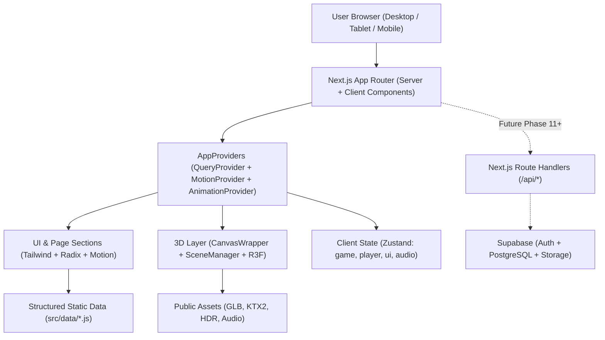
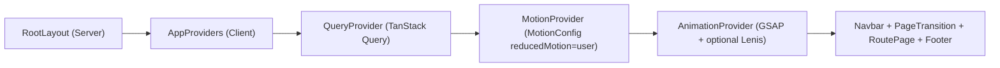
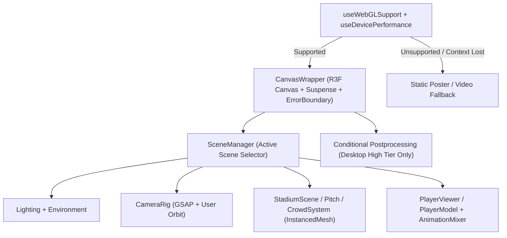
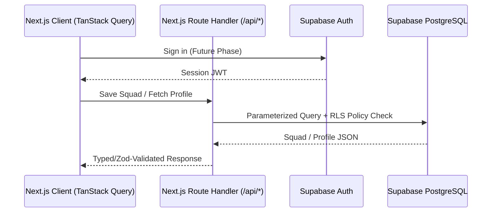

# 04 — System Architecture

## Table of Contents
1. [High-Level Architecture](#1-high-level-architecture)
2. [Frontend Layering & Provider Tree](#2-frontend-layering--provider-tree)
3. [3D Rendering Pipeline](#3-3d-rendering-pipeline)
4. [Animation Orchestration Flow](#4-animation-orchestration-flow)
5. [Asset-Loading & Caching Strategy](#5-asset-loading--caching-strategy)
6. [State Management Architecture](#6-state-management-architecture)
7. [Future Backend & Supabase Integration](#7-future-backend--supabase-integration)
8. [Error-Handling & Fallback Strategy](#8-error-handling--fallback-strategy)

---

## 1. High-Level Architecture

RIVALRY 90 follows a modular **Next.js App Router** architecture with strict separation between Server Components (routing, metadata, static data loading) and Client Components (WebGL Canvas, GSAP/Motion animations, Zustand stores, Howler audio).

## 2. Frontend Layering & Provider Tree

- **Server Components by Default:** Every `page.jsx` under `src/app/` starts as a Server Component to keep bundle sizes minimal and export SEO metadata.
- **Explicit `'use client'` Boundaries:** Only interactive UI widgets, Zustand consumers, GSAP/Motion wrappers, and React Three Fiber components declare `'use client'`.

## 3. 3D Rendering Pipeline

- **Single Active Heavy Canvas:** Only one primary WebGL context is mounted per view to avoid hitting browser WebGL context limits (typically 8–16 contexts).
- **Dynamic Imports:** Heavy 3D scene modules use `next/dynamic` with `ssr: false` so Three.js never attempts to touch `window` or `WebGLRenderingContext` during SSR.

## 4. Animation Orchestration Flow

1. **GSAP + ScrollTrigger (`src/lib/gsap.js`):** Registered once on the client. Controls scroll-pinned scenes, section reveals, and camera coordinate interpolation.
2. **Lenis (Optional):** Synchronized with `ScrollTrigger.update` inside `AnimationProvider.jsx` and bypassed automatically if `prefers-reduced-motion` is active.
3. **Motion for React:** Handles hover elevation, modal sheets, mobile drawers, and card entrances via `<MotionConfig reducedMotion="user">`.
4. **Three.js `AnimationMixer`:** Runs inside `useFrame` for skeletal GLTF player animations.

## 5. Asset-Loading & Caching Strategy

- **Hero First:** Hero stadium/pitch preview assets preload first; secondary routes (Players, Teams, Stadium, Media) load assets lazily on route entry or intersection.
- **Compression:** Meshes target Draco/Meshopt GLB; textures target KTX2/Basis or WebP/AVIF.
- **Validation:** `scripts/validate-assets.mjs` checks manifest integrity and warns on oversized unoptimized files.

## 6. State Management Architecture

| Store | Responsibility | Persisted? |
|---|---|---|
| `uiStore` | Mobile menu open state, active modal, global loading overlay, quality tier | Quality tier optional |
| `playerStore` | Selected player ID, active animation clip (`idle`, `run`, `shoot`), filter query | No |
| `gameStore` | Active game mode, selected formation (`4-3-3`, etc.), squad slot assignments | LocalStorage optional |
| `audioStore` | User opt-in enabled flag, muted state, volume levels (default: muted/off) | LocalStorage optional |

## 7. Future Backend & Supabase Integration

During the MVP frontend phase, `src/lib/supabase.js` safely returns `null` when `NEXT_PUBLIC_SUPABASE_URL` and `NEXT_PUBLIC_SUPABASE_ANON_KEY` are empty, preventing runtime crashes.

## 8. Error-Handling & Fallback Strategy

- **Route Error Boundaries:** `src/app/error.jsx` and `src/app/not-found.jsx` catch route-level failures.
- **3D Error Boundary:** `ErrorFallback.jsx` wraps `CanvasWrapper.jsx` to catch GLTF load failures or WebGL context loss and display an athletic fallback card with retry option.
- **Asset Guards:** `PlayerModel.jsx` renders a procedural geometric stand-in or asset-unavailable indicator when a `.glb` file has not yet been placed in `public/models/`.

---

**Related Documents:** [07 — 3D Architecture](./THREE_JS_3D_ARCHITECTURE.md) · [10 — Component Architecture](./COMPONENT_ARCHITECTURE.md) · [16 — Database & Backend Plan](./DATABASE_AND_BACKEND_PLAN.md)

