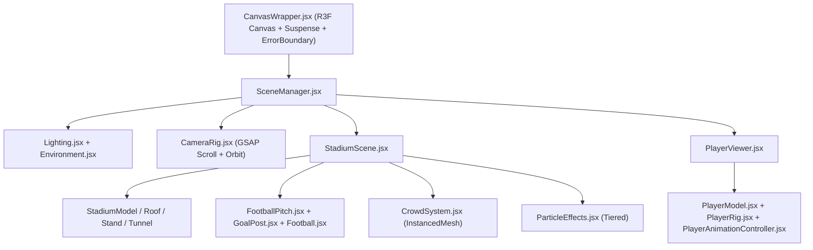

# 07 — Three.js & 3D Web Architecture

## Table of Contents
1. [3D Architecture Overview](#1-3d-architecture-overview)
2. [Scene Hierarchy & Component Responsibilities](#2-scene-hierarchy--component-responsibilities)
3. [Stadium System](#3-stadium-system)
4. [Football Player & Animation Rig](#4-football-player--animation-rig)
5. [Instanced Crowd System](#5-instanced-crowd-system)
6. [Football Pitch, Goals & Ball](#6-football-pitch-goals--ball)
7. [Camera Rig, Lighting & Postprocessing](#7-camera-rig-lighting--postprocessing)
8. [Error Handling & Mobile Fallback Strategy](#8-error-handling--mobile-fallback-strategy)

---

## 1. 3D Architecture Overview

## 2. Scene Hierarchy & Component Responsibilities

| Component (`src/components/3d/`) | Responsibility |
|---|---|
| `CanvasWrapper.jsx` | Mounts React Three Fiber `<Canvas>`, configures `dpr` by device tier, tone mapping (`ACESFilmicToneMapping`), `<Suspense>`, and WebGL `ErrorFallback`. |
| `SceneManager.jsx` | Selects which scene subgraph is mounted (`stadium`, `player`, `pitch-preview`, `trophy`) so unused heavy scenes are never resident simultaneously. |
| `StadiumScene.jsx` | Composes pitch, stadium bowl, floodlights, crowd, and atmosphere. Renders a clean procedural stadium primitive scaffold until final `.glb` assets arrive. |
| `PlayerViewer.jsx` | Isolated turntable/stage canvas for `/players/[playerId]` and home `PlayerShowcase`. |
| `PlayerModel.jsx` | Loads GLB via `useGLTF` with Draco/Meshopt support; renders a clean athletic wireframe/mannequin fallback if asset path is absent. |
| `PlayerAnimationController.jsx` | Wraps Three.js `AnimationMixer` / `useAnimations` for smooth crossfading (`fadeIn(0.25)`) between `idle`, `walking`, `running`, `dribbling`, `shooting`, and `celebration`. |

## 3. Stadium System

- **Structure (`StadiumModel.jsx`, `StadiumRoof.jsx`, `StadiumStand.jsx`, `StadiumTunnel.jsx`):** Modular rings so upper roof trusses or outer facades can be culled when the camera enters the tunnel or pitch level.
- **LED Advertising Boards:** Animated emissive trim strips using UV-offset shaders or low-cost canvas textures (no heavy per-frame DOM textures).
- **Floodlights & Scoreboard:** Emissive light cones + volumetric-style transparent additive planes instead of expensive real-time volumetric raymarching.

## 4. Football Player & Animation Rig

- **Model Format:** Binary `.glb` exported from Blender with Mixamo-compatible humanoid skeleton (`Hips`, `Spine`, `LeftArm`, `RightLeg`, etc.).
- **Materials:** PBR `MeshStandardMaterial` with KTX2/WebP albedo, normal, and roughness maps (kit fabric, skin, hair, boots).
- **Clip Blending:** `PlayerAnimationController.jsx` only updates `AnimationMixer` when the canvas is visible in viewport.

## 5. Instanced Crowd System

- **Constraint:** Never instantiate 5,000+ individual `<mesh>` React nodes.
- **Implementation (`CrowdSystem.jsx`, `CrowdInstance.jsx`):** Uses `THREE.InstancedMesh` with precomputed seat tier matrices, per-instance kit/shirt color attributes, and subtle vertex/matrix wave motion during goals or high-energy scroll beats.
- **Density Scaling:**
  - Desktop High: up to `4,000` instanced silhouettes.
  - Tablet / Medium: `1,500` instances.
  - Mobile Low: `400` instances or static stand texture.

## 6. Football Pitch, Goals & Ball

- **FootballPitch.jsx:** Regulation proportions (`105m x 68m` scaled cleanly to scene units, e.g. `1 unit = 1m` or `0.1` scale), crisp procedural/textured mowed stripe pattern, white chalk markings, corner flags, and dual `GoalPost.jsx` assemblies.
- **Football.jsx:** Dedicated icosahedron/panelled sphere asset with future `@react-three/rapier` rigid-body integration option.

## 7. Camera Rig, Lighting & Postprocessing

- **CameraRig.jsx:** Exposes deterministic `camera.position` and `lookAt` targets driven either by GSAP scroll timelines or user `OrbitControls` (with `enablePan={false}` and polar angle clamps so users cannot clip under the pitch).
- **Lighting.jsx:** Combined hemisphere fill + 1 primary shadow-casting directional/spot key light (2048x2048 shadow map on desktop, 1024x1024 on tablet, disabled real-time shadows on low mobile tier) + floodlight rim accents.
- **Postprocessing:** `@react-three/postprocessing` (`EffectComposer`, `Bloom` with high luminance threshold `> 1.0` so only floodlights/lime accents glow) enabled strictly on `high` performance tier.

## 8. Error Handling & Mobile Fallback Strategy

1. `useWebGLSupport()` probes WebGL2/WebGL1 before mounting `<Canvas>`.
2. If WebGL is unavailable, context is lost, or user enables Low Power Mode fallback, `CanvasWrapper` renders a crisp high-contrast stadium poster image + diagnostic badge.
3. Missing `.glb` URLs never crash the route—components degrade gracefully to procedural geometric stand-ins.

---

**Related Documents:** [08 — Animation Guide](./ANIMATION_AND_INTERACTION_GUIDE.md) · [09 — 3D Asset Pipeline](./3D_ASSET_PIPELINE.md) · [11 — Performance Optimization](./PERFORMANCE_OPTIMIZATION.md)

