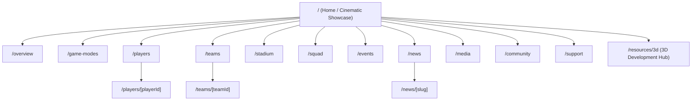

# 05 — Website Structure & Sitemap

## Table of Contents
1. [Sitemap Diagram](#1-sitemap-diagram)
2. [Navigation Architecture](#2-navigation-architecture)
3. [Page Specifications](#3-page-specifications)
4. [Internal Developer Routes](#4-internal-developer-routes)
5. [Page Transition & Breadcrumb Rules](#5-page-transition--breadcrumb-rules)

---

## 1. Sitemap Diagram

## 2. Navigation Architecture

- **Primary Desktop Navbar:** Brand wordmark (`RIVALRY 90`), 6 core top-level links (`Overview`, `Game Modes`, `Players`, `Teams`, `Stadium`, `Squad`), secondary links (`Events`, `News`, `Media`, `Community`), Audio Toggle, and CTA button (`3D Hub` / `Explore Modes`).
- **Mobile Navigation (`MobileNavigation.jsx`):** Slide-over drawer triggered by menu icon (`< 1024px`), keyboard-trapped, Escape-closable, featuring all routes grouped by *Experience*, *Competition*, and *Studio*.
- **Footer Navigation:** 4-column structured links (*Game Universe*, *Competition*, *Community & Support*, *Developer & Legal*) plus original RIVALRY 90 disclaimer.

## 3. Page Specifications

| Route | Purpose | Key Sections & Components | 3D / Animation Needs |
|---|---|---|---|
| `/` | Flagship landing & stack status / cinematic entry | `HeroSection`, `StadiumSection`, `PlayerShowcase`, `GameModesSection`, `FinalCTASection` | Primary `CanvasWrapper` + GSAP ScrollTrigger 8-scene arc |
| `/overview` | Deep-dive game universe & feature pillar overview | Universe pillars, engine highlights, studio philosophy | Optional lightweight ambient stadium header |
| `/game-modes` | Interactive breakdown of playable modes | `GameModesSection`, `GameModeCard` (Career Dynasty, Rivals Ranked, Street 5v5, Global Cup) | Motion tab & card elevation |
| `/players` | Searchable & filterable fictional athlete roster | `PlayerFilters`, `PlayerCard` grid, position/rating filters | Hover glow & quick-inspect triggers |
| `/players/[playerId]` | Individual athlete bio, attributes, & 3D pose viewer | `PlayerProfile`, `PlayerStats`, `PlayerViewer`, `PlayerAnimationSelector` | Dedicated `PlayerViewer` R3F canvas + `AnimationMixer` |
| `/teams` | Fictional clubs showcase | `TeamCard` grid with kit colors, league, tactical rating | Motion card transitions |
| `/teams/[teamId]` | Club crest, squad roster links, home arena | `TeamProfile`, roster cards, home stadium link | Subtle accent lighting |
| `/stadium` | Interactive arena explorer | `StadiumSection`, `StadiumScene`, floodlight/camera presets | Interactive `StadiumScene` R3F canvas + `CameraRig` |
| `/squad` | Interactive formation & lineup planner | `SquadBuilder`, `FormationSelector`, `SquadPlayerSlot` | Motion slot transitions + Zustand `gameStore` |
| `/events` | Seasonal cups, qualifiers, esports schedule | `EventsSection`, `EventCard`, status badges | Countdown / status chips |
| `/news` | Studio dispatches, patch notes, lore | `NewsGrid`, `NewsCard`, category filters | Clean editorial reveal |
| `/news/[slug]` | Full article view with related dispatches | Article typography, author/date metadata, breadcrumbs | Minimal distraction |
| `/media` | Concept renders, trailers, wallapers | `MediaGallery` with category filter tabs & modal lightbox | Motion lightbox |
| `/community` | Fan hubs, creator program, Discord/social links | `CommunitySection`, creator guidelines | Motion hover states |
| `/support` | FAQ accordion + validated support request form | React Hook Form + Zod validated ticket form | Accessible focus states |

## 4. Internal Developer Routes

- **`/resources/3d` (`RIVALRY 90 – 3D DEVELOPMENT HUB`):** Internal dashboard for 3D software, npm packages, asset libraries, optimization validators, licensing checklist, and installation status.

## 5. Page Transition & Breadcrumb Rules

- Detail routes (`/players/[playerId]`, `/teams/[teamId]`, `/news/[slug]`) render clear breadcrumbs (`Home / Players / Kai Vance`).
- Route transitions use lightweight opacity/translate wrappers (`PageTransition.jsx`) respecting `prefers-reduced-motion`.

---

**Related Documents:** [02 — PRD](./PRODUCT_REQUIREMENTS_DOCUMENT.md) · [06 — Design System](./UI_UX_DESIGN_SYSTEM.md) · [10 — Component Architecture](./COMPONENT_ARCHITECTURE.md)

